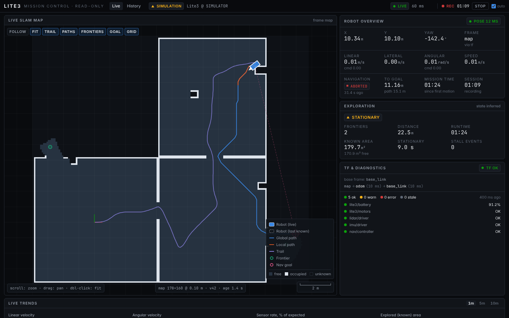

# Lite3 Monitoring Dashboard

A live mission-control dashboard for the Deep Robotics **Lite3** robot dog, built by Group 8 for
the Intelligent Robotics course. While the robot explores the competition arena, the team watches
its SLAM map, position, speed, sensor health, the Raspberry Pi's camera findings and the mission
reports from any laptop, and records each run to compare later.

**It only watches.** The bridge on the robot subscribes to topics and nothing else: it never
publishes, never calls services or actions, never changes parameters, never starts or stops nodes,
and never runs anything the dashboard sends. An automated audit checks this on every push
([SAFETY.md](lite3-monitor/docs/SAFETY.md)).



## How it works

```
 Laptop (Mac / Windows)                              NUC (Ubuntu 22.04, ROS 2 Humble)
 ┌──────────────────────────────┐    SSH tunnel    ┌────────────────────────────────────┐
 │ Browser → Next.js :3000      │  127.0.0.1:8765  │ lite3_bridge (FastAPI, localhost)  │
 │   Live page   (WebSocket)    │◀────────────────▶│   ROS 2 subscriptions only         │
 │   History page               │                  │   latest values, throttled pushes  │
 │ recorded runs → data/*.json  │                  │ robot software (untouched)         │
 └──────────────────────────────┘                  └────────────────────────────────────┘
```

- **Bridge** (`lite3-monitor/bridge/`, Python, FastAPI, rclpy): runs on the NUC and finds each
  data source (map, odometry, LiDAR, IMU, …) by trying a list of candidate topics. It sends JSON
  over a WebSocket that only listens on `127.0.0.1`, so nothing on the robot is exposed to the network.
- **Dashboard** (`lite3-monitor/web/`, Next.js 15, TypeScript, Tailwind): runs on each team
  member's laptop and reaches the bridge through an SSH tunnel. Several people can watch at once.
- **Simulator**: `lite3_bridge --sim` runs a fake exploring robot, so the whole stack works
  with no robot at all.

## What you see

**Live page**
- SLAM map with the robot's pose and trail, planned paths, frontiers, the nav goal and a 1 m grid.
  If telemetry stops, the robot is drawn as a dashed **LAST KNOWN** outline under a red banner.
- Robot overview: position, heading, measured vs commanded speed, navigation status, mission time.
- Exploration: state, frontiers, distance travelled, area covered, stalls.
- Health: every monitored topic's rate vs expected, its age and publisher count, the TF chain, diagnostics.
- Link delay over Wi-Fi + tunnel, NUC compute and temperatures, data per topic.
- Robot body (tilt), robot log and event log.
- **Raspberry Pi panels:** the Pi's status and link, *Pi sees now* (live detections), *Claude scene
  checks* with their pictures, and *Mission reports* sent for scoring.

**History page**: every recorded run (1 Hz samples) with its trajectory, events and charts.
Compare up to four runs and export JSON or CSV.

## Quick start

Requirements: Node.js 20 or newer, Python 3.10 or newer.

**Try it with the simulator** (no robot):

```bash
cd lite3-monitor
./scripts/mac/install.sh
./scripts/mac/start-sim.sh          # → http://127.0.0.1:3000
```

On Windows (PowerShell):

```powershell
cd lite3-monitor
powershell -ExecutionPolicy Bypass -File scripts\windows\install.ps1
powershell -ExecutionPolicy Bypass -File scripts\windows\start-sim.ps1
```

Simulator options: `--dropouts` (simulated Wi-Fi loss), `--latency 150` (slow link),
`--profile group8` (behaves like our robot).

**Watch the real robot.** After the one-time setup in
[TEAM_SETUP.md](lite3-monitor/docs/TEAM_SETUP.md), one command starts the bridge on the NUC (or
reuses one that is already running), opens the tunnel and starts the dashboard:

```bash
cd lite3-monitor
./scripts/mac/start-all.sh
```

```powershell
powershell -ExecutionPolicy Bypass -File scripts\windows\start-all.ps1
```

Then open http://127.0.0.1:3000 and press **Record session** before the run. The day-to-day
procedure, including the Pi setup and troubleshooting, is in the
**[start-up manual](lite3-monitor/docs/STARTUP_MANUAL.md)**.

## Tests

```bash
cd lite3-monitor/bridge && .venv/bin/python -m pytest -q    # bridge, simulator, perception
cd lite3-monitor/web && npm run typecheck && npm test       # dashboard
python3 lite3-monitor/tools/check_readonly.py               # read-only audit
```

GitHub Actions runs all three, plus a production build and the Windows install, on every push.

## Documentation

| Document | What's in it |
|---|---|
| [lite3-monitor/README.md](lite3-monitor/README.md) | Full technical overview, configuration, live-robot rollout |
| [STARTUP_MANUAL.md](lite3-monitor/docs/STARTUP_MANUAL.md) | Running it on the robot, every session |
| [TEAM_SETUP.md](lite3-monitor/docs/TEAM_SETUP.md) | Mac / Windows setup, SSH access, several viewers |
| [ARCHITECTURE.md](lite3-monitor/docs/ARCHITECTURE.md) | Components, data flow, performance budget |
| [PROTOCOL.md](lite3-monitor/docs/PROTOCOL.md) | WebSocket message format |
| [SAFETY.md](lite3-monitor/docs/SAFETY.md) | Read-only guarantees and how they are enforced |
| [NUC_INTEGRATION.md](lite3-monitor/docs/NUC_INTEGRATION.md) | Deploying the bridge to the robot |
| [HANDOVER.md](HANDOVER.md) | Change log, status and open questions |
| [AGENTS.md](AGENTS.md) | Rules for coding agents working on this repo |

## Related repositories

- [Lite3-Autonomous-Navigation](https://github.com/JaimieSE/Lite3-Autonomous-Navigation): the robot's navigation and autonomous roaming
- [Lite3-Live-Mission](https://github.com/JaimieSE/Lite3-Live-Mission): Pi mission reporter and scene checks
- [Lite3-Scene-Understanding](https://github.com/JaimieSE/Lite3-Scene-Understanding): camera, YOLO and Claude scene scripts
- [Lite3-Rescue-Mission](https://github.com/JaimieSE/Lite3-Rescue-Mission): mission objective store
